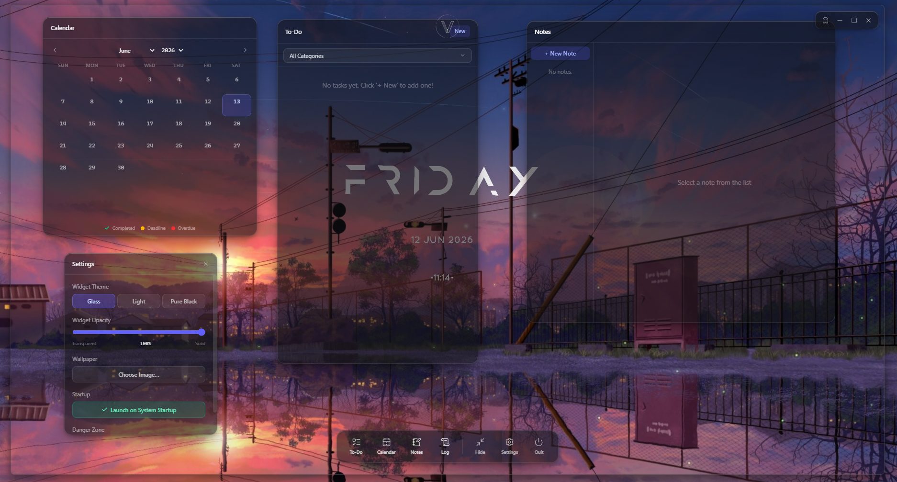
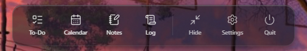
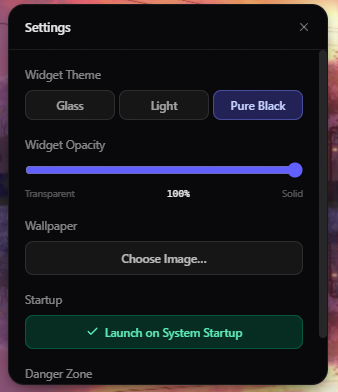

<div align="center">

<picture>
  <source media="(prefers-color-scheme: dark)" srcset="./docs/logo.svg">
  <source media="(prefers-color-scheme: light)" srcset="./docs/logo-charcoal.svg">
  
</picture>

# Vellum

### A Beautiful, Frameless, Glassmorphism Productivity Workspace.

[](https://tauri.app/)
[](https://react.dev/)
[](https://www.typescriptlang.org/)
[](https://www.rust-lang.org/)
[](https://github.com/pmndrs/zustand)
[](https://github.com/SYcstA/Vellum/releases)

</div>

---

## Overview

Vellum is a modern, lightweight desktop productivity application that blends seamlessly into the user's workflow. It features a frameless, translucent glassmorphism UI that defaults to a centered **95% screen ratio**, allowing the desktop wallpaper to shine through — no clunky window chrome, no jarring transitions, just your work, layered over your desktop.

Built on **Tauri 2** (a native Rust shell + a React/TypeScript frontend), Vellum stays under 5 MB on disk and idles at single-digit RAM. The whole thing feels less like an Electron app and more like a native OS component.

<!-- Drop a hero shot here — recommended size: 1600×1000, .png -->
<div align="center">



*The Vellum dashboard — frameless, centered, glass.*

</div>

---

## What's New in v0.3.0

### Backup & Restore
**Settings → Backup** exports everything (tasks, notes, tags, links, activity log) to a single `.json` file and imports it back. Importing validates the whole file first, shows what it contains, saves a safety copy of your current data to `%APPDATA%\com.osvaldo.vellum\backups\`, and only then replaces your data.

### Quick Capture
Open a small always-on-top box from the **tray menu** (or assign a hotkey in Settings). Type a task and press Enter (it lands in an **Inbox** tag), or start with `n:` to save a note instead. The dashboard updates live.

### All Shortcuts in One Place
**Settings → Shortcuts** lists every hotkey with where it works (Ghost Mode, Quick Capture, New note, Search notes). Click a key box and press a new combo to change it; Reset restores the default and Clear turns an optional one off.

### Deadline Reminder
Turn on **Settings → Deadline Reminder** for one daily notification listing tasks due today or past due, at a time you choose, or when you open Vellum later in the day. Works while Vellum is running (pair it with *Launch on System Startup*).

### Never Lose a Draft
An unsaved **New Note** is autosaved and comes back after closing the widget or restarting. **Ctrl + N** starts a new note and **Ctrl + F** jumps to note search (both rebindable).

### Finished Late
A task completed after its deadline keeps a small orange mark; the Calendar shows those days with an orange tick and lists them under *Completed late*.

### Polish & Fixes
- Ghost Mode hotkey is now **Ctrl + Alt + G** (the old Alt + G is migrated automatically); rebinding uses the physical key and keeps your old hotkey if the new one is taken.
- Launching Vellum twice focuses the running window instead of opening a second copy.
- Links in notes open in your browser on click; right-click for Link / Open / Remove. YouTube, YouTube Music and Spotify links get a badge.
- The rich-text editor loads only when you open a note, so the app starts with a much smaller bundle.
- Fixed: wrong text colour after switching themes, unreadable dialogs in dark mode, completed tasks appearing twice in the calendar popup.

---

## What's New in v0.2.0

### Rich Text Notes (TinyMCE)
Notes now use a full **TinyMCE 8.6** rich-text editor — bold, italic, lists, links, headings, and more. Legacy plain-text notes are auto-converted to HTML on open, so no data is lost on upgrade. The editor is fully themed to match each widget skin (Dark Glass, Frosted Light, Pure Black), including toolbar icons and overflow menus.

### Multi-Tag Tasks (M:N)
Tasks now support **multiple tags** simultaneously. The primary tag is shown as the first chip; extra tags appear alongside it. Add and remove tags freely from the task edit form. The SQL layer uses a proper `Task_Tags` pivot table with ON DELETE CASCADE, so deleting a tag cleans up gracefully.

### Drag & Drop Reorder
Drag the **grip handle** (⠿) on any pending task or note to reorder it. Order is persisted to SQLite via a `Position` column — reopen the app and the order is exactly as you left it. Drag handles are hidden automatically when a filter or search is active to prevent confusing reorder semantics.

### Resizable Notes Splitter
The note list and editor panes in the Notes widget are now separated by a **drag-to-resize splitter**. Pull it left or right to give more room to the list or the editor. The width is saved to localStorage and restored on next open.

### Search Everywhere
- **Task search** — filters by task title or any of its tags.
- **Note search** — searches note titles and the full rich-text content (HTML stripped before matching).

### Activity Log — Simple & Advanced Modes
The Activity Log now has a **Simple / Advanced** toggle in its header.
- **Simple** shows a one-line summary per action.
- **Advanced** shows a delta breakdown: what was renamed, which deadline changed (`old → new`), which tags were added or removed (`+[A] −[B]`), and how many characters changed in a note edit (`±N chars`).

### Rebindable Ghost Mode Shortcut
The Ghost Mode hotkey is no longer hardcoded to `Alt+G`. Open **Settings → Ghost Mode Shortcut**, click the button, and press any modifier + key combo. The new shortcut is saved, applied immediately in the Rust backend, and shown live in the Ghost button tooltip.

---

## Core Features

### Smart Widgets
Independently draggable, resizable widgets for **To-Do**, **Notes**, **Calendar**, and an **Activity Log**. Every widget enforces strict screen-boundary clamping on mount, drag, and resize — so they never get lost off-screen, even after resolution changes or monitor unplugs.

<div align="center">



</div>

### Ghost Mode (Escape Hatch)
Need to click *through* Vellum to interact with the desktop underneath? Toggle **Ghost Mode** from the title bar. The window becomes fully click-through — perfect for keeping a checklist visible while you work in another app. Press your configured shortcut (default **`Alt + G`**) at any time to instantly restore interactivity.

### Bi-directional Note ↔ Task Linking
Click any task that has linked notes and a **note-picker popup** appears — listing every linked note by title so you can jump directly to the right one. From the Notes side, use the **Link to tags** panel to attach a note to all tasks of a given category in one click.

### Persistent State
Vellum remembers your **window size**, **widget positions**, **theme** (Dark Glass · Frosted Light · Pure Black), **opacity**, **wallpaper**, **Ghost Mode shortcut**, and **drag-reorder positions** across every session.

<div align="center">



*Dark Glass · Frosted Light · Pure Black*

</div>

### Autostart Ready
Flip a single toggle in Settings to launch Vellum silently in the background on system boot. Hides to the tray on close; one click to bring it back.

---

## Installation

1. Head to the [**Releases page**](https://github.com/SYcstA/Vellum/releases) and grab the latest `Vellum_0.3.0_x64-setup.exe`.
2. Run the installer (NSIS, published by **YcstA**).
3. Launch Vellum from the Start menu or pin it to the taskbar.

**Upgrading from v0.1.0?** Run the new installer over the old one. The NSIS installer detects the existing install, replaces only the binaries, and leaves your data directory (`%APPDATA%\com.osvaldo.vellum\`) untouched. On first launch, v0.2.0 automatically migrates your database (adds the new `Task_Tags` pivot and `Position` ordering columns) — no manual steps needed.

---

## Local Development

**Prerequisites:** Node.js 20+, Rust toolchain, and the platform-specific Tauri prereqs ([see Tauri docs](https://tauri.app/start/prerequisites/)).

```bash
# Install dependencies
npm install

# Run in dev mode (hot-reload on the frontend, Rust rebuilds on change)
npm run tauri dev

# Build a production installer (.exe + NSIS bundle)
# Output: src-tauri/target/release/bundle/nsis/Vellum_0.3.0_x64-setup.exe
npm run tauri build
```

---

## Tech Stack

| Layer | Tech |
|---|---|
| Native shell | Tauri 2 · Rust |
| Frontend | React 19 · TypeScript 5 · Vite 7 |
| Styling | Tailwind CSS 4 + custom glassmorphism design tokens |
| State | Zustand 5 (persisted via `localStorage`) |
| Persistence | SQLite (via `tauri-plugin-sql`) |
| Rich Text | TinyMCE 8.6 (self-hosted) |
| Drag & Drop | `@hello-pangea/dnd` |
| Icons | `lucide-react` |

---

## Screenshots Folder

All README images live in [`./docs/`](./docs/). To swap in your own screenshots, drop PNGs/GIFs in there with these filenames:

| Filename | What it shows | Suggested size |
|---|---|---|
| `screenshot-dashboard.png` | Hero shot of the full dashboard | 1600×1000 |
| `screenshot-widgets.png` | Widgets close-up | 1400×900 |
| `screenshot-themes.png` | Theme switcher side-by-side | 1600×600 |

---

<div align="center">

Developed with ❤️ by **YcstA**.

</div>
